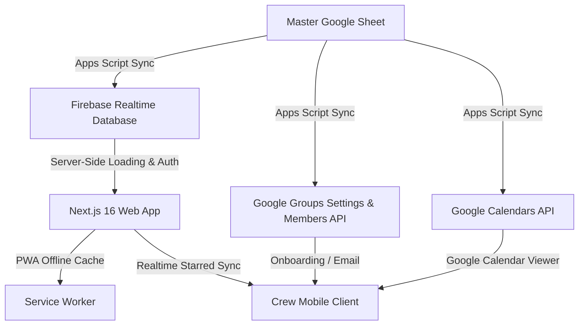

# Operational Proposal: The Portal Map & Run-of-Show App

**Prepared for:** The Portal (Experiential Design & Production)  
**Date:** July 25, 2026  
**Status:** Shipped (PoC Draft Finalized)

---

## Executive Summary

The Portal Map & Run-of-Show (ROS) Application is a secure, interactive map and schedule viewer custom-designed for event production crews. Forked from our proven `bbb-map-app` framework, this platform bridges the gap between static spreadsheet planning and dynamic, day-of-show operations. 

By automating Google Workspace (Groups & Calendars) provisioning directly from a live Google Sheet and syncing database operations in real-time to a mobile-responsive web app, we provide a unified "source of truth" that ensures crew members have the right information, at the right time, relative to their specific roles and departments.

---

## Tiered Scope of Work & Shipped Features

We have designed and built toward **Option B (Operational PoC)** while ensuring a clean path for the **Option A MVP** shared view.

### 🟢 Option A: MVP Shared View (Concept Validation)
* **Goal**: Validate that existing spreadsheet data and geofenced coordinates can power an interactive, clean, client-facing interface.
* **Pricing**: $2,500 (Approx. 10 Days)
* **Features Delivered**:
  * **Unified Map View**: An interactive Google Map displaying geofenced categories (venues, forest areas, services, etc.) with custom category filters.
  * **Interactive Schedule Timeline**: A responsive running schedule matching events to map geolocations with day-by-day tabs.
  * **Fuzzy Search & Filtering**: Client-side filtering by keyword, event category, or department.
  * **Static spreadsheet integration**: A parser script that ingests geocoded venues and schedule items from a central file.
  * **Interim Portal Branding**: Custom typography, sleek dark mode variables, and styling inspired by `theportal.is`.

---

### 🔵 Option B: Operational PoC (Production-Ready Platform)
* **Goal**: Implement full backend automation, role-based visibility control, offline functionality, and Workspace pipeline integrations for production use.
* **Pricing**: $5,000 (Approx. 20 Days)
* **Features Delivered**:
  * **Role-Based Gated Auth**:
    * Full integration replacing shared passwords with role-based logins (Admin, Lead, Vendor, Guest).
    * NextAuth integration with Firebase Custom Token minting.
    * Gated server-side endpoints and UI controls based on active roles.
  * **Day-of-Show (Now/Next) Dashboard**:
    * An operational dashboard displaying active events happening *now* (with real-time progress bars) and upcoming events scheduled in the next 2 hours.
    * Integrated simulation mode for off-event testing.
  * **Real-time Synchronization & Notifications**:
    * Real-time Firebase database listeners update schedules and map markers instantly.
    * Client-side toast notifications slide in when an event's time or location is edited in the master spreadsheet.
  * **Starred Personal Agenda**:
    * Crew members can "star" events to curate their own timeline.
    * Stars sync in real-time to the database under their profile and fall back gracefully to local storage if offline.
  * **PWA Offline Support**:
    * Service worker (`sw.js`) and manifest caching allow the app shell, map pins, and schedules to load offline in remote areas.
    * A header banner displays offline status and the last sync timestamp.
  * **Google Calendar & Groups Integration**:
    * Automated background synchronization script (`PortalSyncScript.js`) that runs on Google Apps Script.
    * Automatically syncs events from the `ROS by TIME` tab to distinct Google Calendars per department, preventing duplicates.
    * Auto-manages Google Group subscription memberships.
    * **Preserves special characters**: Correctly handles ampersands (e.g. `F&B` $\rightarrow$ `f&b@yourdomain.com`).
    * **Self-healing Calendar Provisioning**: Automatically detects deleted or inaccessible calendar IDs in the spreadsheet, recreates them under the execution profile, and writes the new IDs back to the sheet.
    * **Clutter-Free Onboarding Emails**: Automatically detects Admin / All Departments users and invites them to the single `all-departments@` group (which has calendar read ACLs), while packing all calendar subscription links under a collapsed HTML `
` element in their email.

---

## Technical Architecture

1. **Data Layer**: Live Google Sheet (`Locations`, `Personnel`, `Departments`, `ROS` tabs).
2. **Synchronization Pipeline**:
   * Runs in Google Apps Script.
   * Pushes raw data to Firebase.
   * Manages Workspace memberships (Directory API) and permissions (Calendar ACLs).
3. **Application Layer**: Next.js 16, React 19, TypeScript, Tailwind/Vanilla CSS, hosted securely on Firebase Hosting.

---

## Handoff & Security Guidelines

To safely transitions this project to a live production environment, the client must provision the following items:

1. **Google Maps API Key**: A restricted, billed Google Cloud Platform key with the *Maps JavaScript API* enabled.
2. **Google Workspace Directory & Calendar API Access**:
   * Enable the Google Groups Settings API and Directory API advanced services.
   * Run the sync script under a designated Google Workspace administrator account (`admin@vvexstudio.com` or similar) to ensure permission scopes are correct.
3. **Firebase Project Ownership**: Transition ownership of the Firebase project, and restrict database write rules solely to the Google Apps Script execution account.

---

## Maintenance & Revisions

* **Scope Includes**:
  * Two rounds of revisions after initial deployment.
  * Handling minor Request for Enhancements (RFEs) following hands-on crew smoke testing.
  * Complete intake schema template guides to make future events plug-and-play.