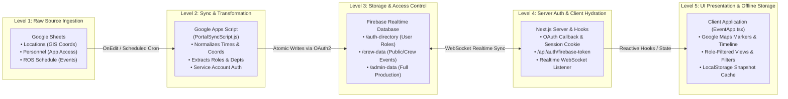
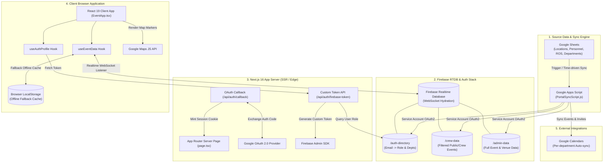
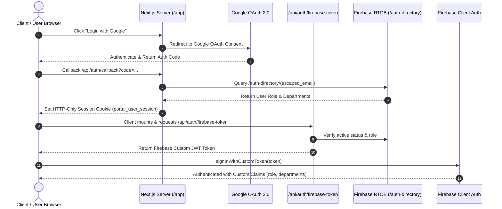

# System Design & Architecture Specification
**Project:** The Portal — Interactive Map & Run-of-Show (ROS) Platform  
**Purpose:** Comprehensive system design schema for architecture review & system design studies.

---

## Visual Architecture Overview


### Data Provider Architecture Schema


---

## Multi-Level Data Flow Pipeline (L1 $\rightarrow$ L5)

### 5-Stage End-to-End Data Flow Pipeline


### Whiteboard System Design Study Sketch


### Multi-Tier Digital Pipeline Architecture




---

## 1. High-Level System Architecture



---

## 2. Component Architecture & Data Flow

### A. Authentication & Session Flow


### B. Real-Time Data Sync Pipeline
1. **Google Sheets as Source of Truth**: Editors update `Locations`, `Personnel`, and `ROS by TIME` tabs.
2. **Apps Script Execution**: `PortalSyncScript.js` triggers on change or cron timer.
   - Parses `Personnel` to map `email` $\rightarrow$ `app_role` (`admin`, `crew`, `guest`).
   - Normalizes schedule times, venue coordinates, and department assignments.
   - Pushes sanitized snapshots to Firebase RTDB:
     - `/auth-directory/${escapedEmail}` $\rightarrow$ User permissions & active status.
     - `/crew-data` $\rightarrow$ Sanitized events accessible to crew & public.
     - `/admin-data` $\rightarrow$ Full detailed production schedule.
3. **Client WebSocket Hydration**: Client subscribes to RTDB via `useEventData(role)`. On update, UI updates instantly without polling or page reloads.

---

## 3. Database Schema & Data Dictionary

### Firebase Realtime Database Structure
```json
{
  "auth-directory": {
    "user_example_com": {
      "role": "admin | crew | guest",
      "departments": ["Lighting", "Audio"],
      "active": true
    }
  },
  "crew-data": {
    "events": [
      {
        "id": "evt-001",
        "title": "Mainstage Soundcheck",
        "scheduleDate": "2026-08-15",
        "startTime": "14:00",
        "endTime": "16:00",
        "locationName": "Main Stage",
        "department": "Audio",
        "leadPointPerson": "Julia",
        "isPublic": false
      }
    ],
    "venues": [
      {
        "id": "loc-001",
        "name": "Main Stage",
        "lat": 43.056,
        "lng": 11.489,
        "permanence": "Stage"
      }
    ]
  },
  "admin-data": {
    "events": "...",
    "venues": "...",
    "personnel": "..."
  }
}
```

---

## 4. Key Security & Resilience Mechanisms

| Layer | Mechanism | Design Description |
|---|---|---|
| **Identity** | Google OAuth 2.0 + HMAC Cookie | Encrypted, cryptographically signed HTTP-only JWT-style session cookies. |
| **Authorization** | RTDB Security Rules (`database.rules.json`) | Role-based data access control enforcing read permissions based on `auth.token.role`. |
| **Offboarding** | Active Gate (`active: false`) | Immediate revocation of token generation and RTDB access upon setting `active: false` in Google Sheet. |
| **Offline Resilience** | Dual-tier Storage (`localStorage` fallback) | Cached local snapshot allows complete offline map and schedule functionality if network fails on-site. |
| **Environment Isolation** | Multi-Project Setup | Complete separation between Developer Sandbox (`portal-dev-6aa34`) and Production Client GCP. |

---

## 5. Technology Stack Summary

- **Frontend**: Next.js 16 (App Router), React 19, TypeScript, Vanilla CSS (Custom Design System), `@vis.gl/react-google-maps`.
- **Backend / Data**: Firebase Realtime Database (RTDB), Firebase Admin SDK, Google Apps Script (`PortalSyncScript.js`).
- **Authentication**: Google OAuth 2.0, Firebase Custom Authentication Tokens.
- **CI/CD & Hosting**: Firebase Hosting, GitHub Actions with Workload Identity Federation (WIF).
